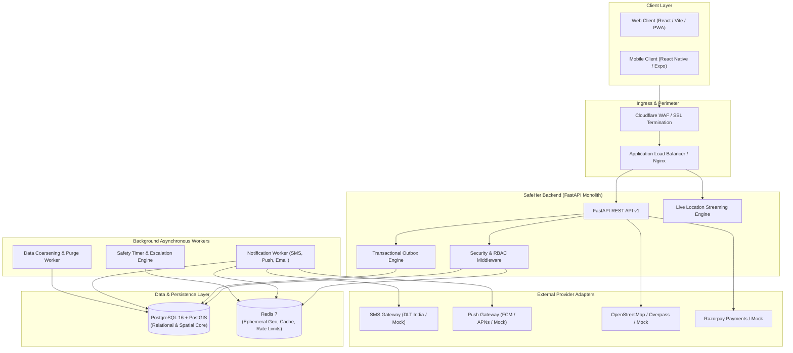
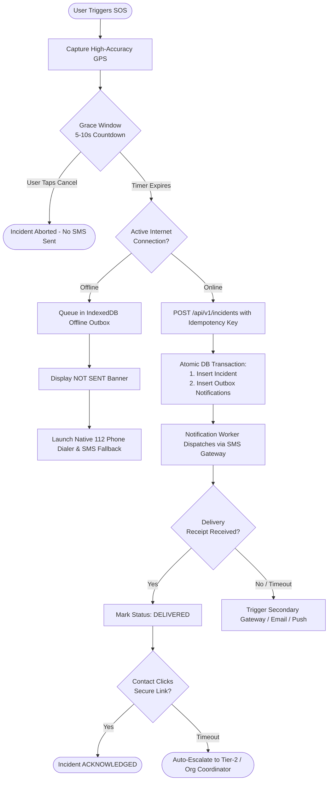
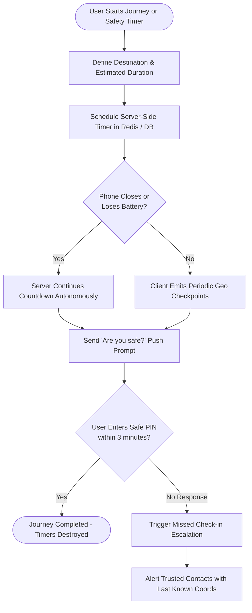
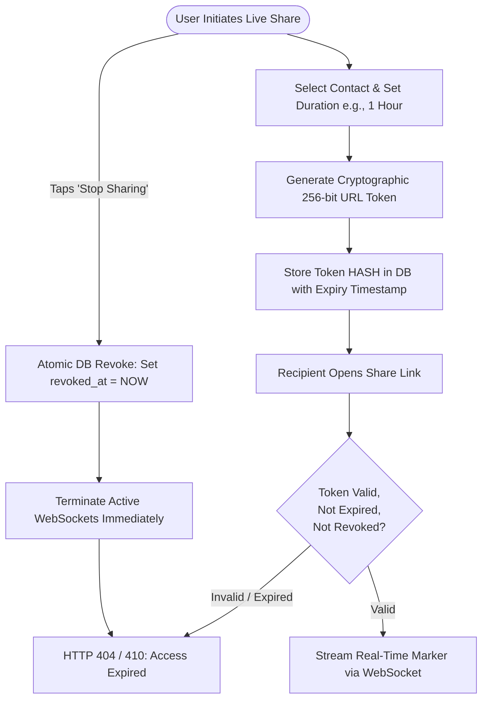

# SafeHer 🛡️

**A Scalable, Privacy-First Women Safety Ecosystem**  
*Empowering individuals, connecting communities, and protecting institutions.*

[](LICENSE)
[](https://python.org)
[](https://fastapi.tiangolo.com)
[](https://react.dev)
[](https://www.typescriptlang.org)
[](https://postgis.net)
[](https://redis.io)
[](https://tailwindcss.com)

---

## 📑 Table of Contents

1. [Project Vision & Identity](#1-project-vision--identity)
2. [The Three Product Pillars](#2-the-three-product-pillars)
3. [Non-Negotiable Safety & Privacy Principles](#3-non-negotiable-safety--privacy-principles)
4. [Technology Stack & Rationale](#4-technology-stack--rationale)
5. [System Architecture & Execution Flowcharts](#5-system-architecture--execution-flowcharts)
   - [5.1. High-Level System Architecture](#51-high-level-system-architecture)
   - [5.2. Smart SOS & Incident Lifecycle Flow](#52-smart-sos--incident-lifecycle-flow)
   - [5.3. Journey Guardian & Safety Timer Engine](#53-journey-guardian--safety-timer-engine)
   - [5.4. Consent-First Location Sharing & Revocation](#54-consent-first-location-sharing--revocation)
   - [5.5. Community Reporting & Spatial Fuzzing Pipeline](#55-community-reporting--spatial-fuzzing-pipeline)
6. [Monorepo Directory Structure](#6-monorepo-directory-structure)
7. [Complete Commands & Execution Guide](#7-complete-commands--execution-guide)
   - [7.1. Prerequisites](#71-prerequisites)
   - [7.2. Docker Compose (Recommended)](#72-docker-compose-recommended)
   - [7.3. Native Local Execution (Windows, Linux, macOS)](#73-native-local-execution-windows-linux-macos)
   - [7.4. Testing & Verification Commands](#74-testing--verification-commands)
   - [7.5. Automated GitHub Push Workflow](#75-automated-github-push-workflow)
8. [India-Specific Regulatory & Operational Compliance](#8-india-specific-regulatory--operational-compliance)
9. [Phased Delivery Roadmap](#9-phased-delivery-roadmap)
10. [Security & Abuse Reporting](#10-security--abuse-reporting)

---

## 1. Project Vision & Identity

**SafeHer** is a production-grade, full-stack safety platform built to operate reliably under extreme real-world constraints: spotty cellular connectivity, battery conservation limits, and high-stress panic conditions. 

Unlike classroom demos or commercial ad-tech tracking apps, SafeHer treats personal location and emergency telemetry as **sacrosanct, sensitive personal data**. It bridges the gap between individual rapid assistance, community-driven civic vigilance, and institutional duty-of-care.

---

## 2. The Three Product Pillars

SafeHer unifies three logically isolated product experiences on a single, hardened core:

```
                                  ┌───────────────────────────────┐
                                  │      SafeHer Unified Core     │
                                  └───────────────┬───────────────┘
                     ┌────────────────────────────┼────────────────────────────┐
                     ▼                            ▼                            ▼
       ┌───────────────────────────┐┌───────────────────────────┐┌───────────────────────────┐
       │     SafeHer Personal      ││     SafeHer Community     ││   SafeHer Organization    │
       ├───────────────────────────┤├───────────────────────────┤├───────────────────────────┤
       │ • One-Thumb Smart SOS     ││ • Hazard & Road Reports   ││ • Multi-Tenant RBAC       │
       │ • Journey Guardian        ││ • Spatial Fuzzing (100m+) ││ • PostgreSQL RLS Security │
       │ • Server-Side Safe Timers ││ • Pseudonymous Reporting  ││ • Emergency Escalations   │
       │ • Ephemeral Live Location ││ • Civic Moderation Queue  ││ • Aggregate Analytics (k≥5)│
       │ • 112 ERSS Direct Dial    ││ • Municipal GIS Feeds     ││ • Zero Secret Tracking    │
       └───────────────────────────┘└───────────────────────────┘└───────────────────────────┘
```

1. **SafeHer Personal:** Geared toward college students, working women, and solo travelers. Features instant SOS dispatch, trusted contact management, client-side offline outboxes, and server-side safety timers that persist even if the phone powers down.
2. **SafeHer Community:** Enables citizens to report poorly lit walkways, damaged infrastructure, transit hazards, or harassment spots. Automatically strips reporter identities and applies spatial fuzzing to protect victims from retaliatory stalking.
3. **SafeHer Organization:** Designed for universities, enterprise campuses, and NGOs. Provides safety coordinators with emergency dispatch tools and aggregate-only analytics ($k \ge 5$) while strictly prohibiting stealth background tracking of employees or students.

---

## 3. Non-Negotiable Safety & Privacy Principles

Every line of code and architectural decision in SafeHer adheres to four foundational rules:

1. **Consent-First:** Telemetry and live location coordinates are accessible **only** with explicit, revocable, and time-bounded authorization. An organization coordinator or contact cannot view your location without active, user-initiated consent.
2. **Fail Loudly, Never Silently:** If an SMS gateway drops, push fails, or cell data is lost, SafeHer **never** presents a false "Sent" state. The UI displays exact delivery receipts and instantly triggers hardware telephony fallbacks (native 112 calling and SMS composer pre-filled with GPS coordinates).
3. **Zero Monetization of Safety Data:** We strictly **never monetize, sell, or broker location data, journey routes, or incident history** for advertising or third-party profiling. Essential emergency SOS features are permanently free and never paywalled.
4. **Data Minimization:** Raw high-frequency GPS points are ephemeral (stored temporarily in Redis during active sessions) and systematically coarsened or purged from PostgreSQL via scheduled retention jobs.

---

## 4. Technology Stack & Rationale

| Layer | Technology | Version | Architectural Rationale |
| :--- | :--- | :--- | :--- |
| **Frontend Framework** | **React** + **TypeScript** | 18.3 / 5.6 | Strict type-safety matching backend Pydantic models; shared logic foundation for upcoming React Native mobile app. |
| **Bundler & Tooling** | **Vite** | 5.4 | Sub-second Hot Module Replacement (HMR) and optimized ES module bundling for fast load times on 3G/4G networks. |
| **UI & Design Tokens** | **Tailwind CSS** | 3.4 | Mobile-first utility design system with semantic emergency tokens (WCAG 2.2 AA contrast compliance). |
| **Data Fetching** | **TanStack React Query** | 5.59 | Automatic caching, background refetching, and query synchronization with offline outbox queues. |
| **Mapping Engine** | **Leaflet** + **OpenStreetMap** | 1.9 | Open-source, zero-licensing cost mapping and raster tile rendering with custom markers for emergency facilities. |
| **Backend Framework** | **FastAPI** | 0.115+ | High-throughput asynchronous Python framework; native OpenAPI schema generation and request validation. |
| **Data Validation** | **Pydantic v2** | 2.7+ | Ultra-fast C-compiled schema validation ensuring malformed payloads are rejected at the application perimeter. |
| **ORM & Database** | **SQLAlchemy 2.0 (Async)** + **PostgreSQL 16** | 2.0 / 16.4 | Modern async database engine with strict ACID transactions, foreign keys, and enterprise reliability. |
| **Spatial Engine** | **PostGIS** | 3.4 | High-performance spatial indexing (GiST, `ST_DWithin`, spatial joins) for sub-millisecond nearby facility lookups. |
| **Cache & Task Broker** | **Redis** | 7.0 | Ephemeral session state, rate-limiting counters, pub/sub for live location feeds, and worker task queues. |
| **Task Engine** | **Transactional Outbox + ARQ / Celery** | - | Prevents lost emergency alerts during network drops or worker crashes via two-phase outbox polling. |
| **Containerization** | **Docker & Docker Compose** | 24+ | Single-command multi-service orchestration across development, staging, and production environments. |

---

## 5. System Architecture & Execution Flowcharts

### 5.1. High-Level System Architecture



---

### 5.2. Smart SOS & Incident Lifecycle Flow



---

### 5.3. Journey Guardian & Safety Timer Engine



---

### 5.4. Consent-First Location Sharing & Revocation



---

### 5.5. Community Reporting & Spatial Fuzzing Pipeline

```mermaid
flowchart TD
    Citizen([Citizen Submits Hazard Report]) --> FormInput[Select Category: Broken Lighting / Harassment / Hazard]
    FormInput --> AttachPhoto[Attach Photo: Metadata & EXIF Stripped Automatically]
    
    AttachPhoto --> SensitiveCheck{Is Category\nSensitive / Harassment?}
    
    SensitiveCheck -- Yes --> ApplyFuzz[Apply Differential Privacy Fuzzing:\nPerturb Coordinates by 100-300m Radius]
    SensitiveCheck -- No --> KeepCoords[Retain Exact Coordinate for Municipal Repair]
    
    ApplyFuzz --> ModQueue[Enqueue in Moderation Queue with Pseudonymized ID]
    KeepCoords --> ModQueue
    
    ModQueue --> ModeratorAction{Human Reviewer\nApproval}
    ModeratorAction -- Rejected --> DropReport([Report Discarded])
    ModeratorAction -- Verified --> PublishPublic[Publish to Public Safety Map\n(Reporter Identity Permanently Hidden)]
```

---

## 6. Monorepo Directory Structure

```
safeher/
├── .github/
│   └── workflows/
│       ├── ci.yml                 # Automated Ruff lint, TypeScript check, unit tests
│       └── security-scan.yml      # Vulnerability & secret scanning
├── docs/
│   ├── ARCHITECTURE.md            # In-depth architectural specifications & ERD
│   ├── THREAT_MODEL.md            # STRIDE threat model & anti-coercion analysis
│   ├── DECISIONS.md               # Architecture Decision Records (ADR 001 - 005)
│   ├── BACKLOG.md                 # Post-MVP enhancement tracking
│   ├── KNOWN_LIMITATIONS.md       # Operating reality documentation
│   └── COMPLIANCE.md              # DPDPA 2023 & CERT-In compliance checklist
├── backend/
│   ├── app/
│   │   ├── main.py                # FastAPI factory, lifespan, CORS, middleware
│   │   ├── core/                  # Config, JSON logging, security, errors, database
│   │   ├── api/v1/                # Versioned routes (/health, /auth, /incidents)
│   │   ├── models/                # SQLAlchemy 2.0 ORM models
│   │   ├── schemas/               # Pydantic v2 input/output schemas
│   │   ├── services/              # Domain business logic
│   │   ├── repositories/          # Isolated data access layer
│   │   ├── integrations/          # Provider adapters (SMS, Push, Maps, Payments)
│   │   └── workers/               # Outbox processors & escalation schedulers
│   ├── tests/                     # Unit, integration, and security test suites
│   ├── Dockerfile                 # Python 3.12-slim production container
│   ├── pyproject.toml             # Ruff and Pytest configurations
│   └── requirements.txt           # Python dependencies
├── frontend/
│   ├── src/
│   │   ├── components/            # Layout, AppHeader, EmergencyFooter, UI primitives
│   │   ├── pages/                 # HomePage, SOSView, JourneysView, SettingsView
│   │   ├── features/              # Modular domain features (auth, emergency, contacts)
│   │   ├── hooks/                 # Custom React hooks (useGeolocation, useOfflineOutbox)
│   │   ├── types/                 # TypeScript type definitions
│   │   ├── styles/                # Tailwind CSS design system tokens
│   │   └── App.tsx                # Primary application component
│   ├── public/                    # PWA icons and web manifest
│   ├── Dockerfile                 # Multi-stage Node builder & Nginx container
│   ├── package.json               # Node dependencies and scripts
│   ├── tailwind.config.js         # Semantic color and typography tokens
│   └── vite.config.ts             # Vite bundler configuration
├── .env.example                   # Master environment configuration template
├── .gitignore                     # Strict Git exclusion list
├── CHANGELOG.md                   # Conventional changelog
├── docker-compose.yml             # Local multi-service orchestrator
└── README.md                      # Primary project documentation
```

---

## 7. Complete Commands & Execution Guide

### 7.1. Prerequisites

Before running SafeHer, verify the following runtimes are installed on your workstation:
- **Node.js:** `v20.x` or `v22.x` (check with `node --version`)
- **Python:** `3.10+` or `3.12` (check with `python --version`)
- **Git:** `2.40+` (check with `git --version`)
- **Docker & Docker Compose** *(Optional for containerized run)*: (check with `docker compose version`)

---

### 7.2. Docker Compose (Recommended)

To run the entire ecosystem (FastAPI, React Frontend, PostgreSQL 16 with PostGIS, and Redis 7) in isolated containers:

```bash
# 1. Clone the repository
git clone https://github.com/Jaspreet-93/safeher.git
cd safeher

# 2. Copy the environment configuration
cp .env.example .env

# 3. Build and launch all services in detached mode
docker compose up --build -d

# 4. View real-time container logs
docker compose logs -f

# 5. Check health status of all containers
docker compose ps

# 6. Stop and teardown containers (preserves database volumes)
docker compose down
```

- **Frontend Application:** [http://localhost:5173](http://localhost:5173)
- **Backend Interactive Swagger Docs:** [http://localhost:8000/docs](http://localhost:8000/docs)
- **API Health Check Endpoint:** [http://localhost:8000/api/v1/health](http://localhost:8000/api/v1/health)

---

### 7.3. Native Local Execution (Windows, Linux, macOS)

If running directly on the host machine without Docker:

#### Step A: Backend Setup

```bash
# Navigate to the backend directory
cd backend

# Create a virtual environment
python -m venv .venv

# Activate the virtual environment
# Windows (PowerShell):
.venv\Scripts\Activate.ps1
# Linux / macOS:
source .venv/bin/activate

# Install dependencies
pip install -r requirements.txt

# Run the backend development server
uvicorn app.main:app --reload --host 0.0.0.0 --port 8000
```

#### Step B: Frontend Setup

```bash
# Navigate to the frontend directory in a separate terminal
cd frontend

# Install dependencies
npm install

# Start the Vite development server
npm run dev
```

---

### 7.4. Testing & Verification Commands

SafeHer enforces zero-defect quality gates. Run these commands prior to committing any code:

```bash
# --- Backend Quality Gates ---
cd backend

# 1. Run Ruff Linter & Check formatting
python -m ruff check .
python -m ruff format --check .

# 2. Automatically fix formatting and trivial lint issues
python -m ruff check --fix .
python -m ruff format .

# 3. Run all unit and integration tests with Pytest
python -m pytest -v

# --- Frontend Quality Gates ---
cd ../frontend

# 1. Run TypeScript type-checker & Vite production build
npm run build
```

---

### 7.5. Automated GitHub Push Workflow

To push incremental changes to the SafeHer GitHub repository:

```bash
# Check modified files
git status

# Stage all changes
git add .

# Create a conventional commit
git commit -m "feat(module): description of completed work"

# Push to the main branch
git push origin main
```

---

## 8. India-Specific Regulatory & Operational Compliance

1. **DLT Transactional SMS Mandate:**
   - Under TRAI regulations, transactional SMS messages in India must be dispatched through registered Principal Entities with approved Header IDs and DLT-registered message templates.
   - SafeHer encapsulates SMS logic behind an abstract `SmsProvider` with a fully functional `MOCK` implementation for local development and unit tests.
2. **National ERSS 112 Direct Dial:**
   - SafeHer places the official **112 emergency telephone action** in high-contrast positions across all interfaces. In panic conditions or when cellular data fails, the app directly invokes the native device dialer via `tel:112`.
3. **DPDPA 2023 (Digital Personal Data Protection Act):**
   - Implements explicit, itemized consent records before collecting telemetry.
   - Restricts data processing strictly to safety purposes (purpose limitation).
   - Provides users with full self-serve data erasure workflows.
4. **CERT-In Direction Alignment:**
   - Generates structured, NTP-synchronized JSON logs with unique request correlation IDs (`X-Request-ID`) to support forensic auditability without logging PII or auth credentials.

---

## 9. Phased Delivery Roadmap

```
 Phase 0  ──►  Phase 1  ──►  Phase 2  ──►  Phase 3  ──►  Phase 4  ──►  Phase 5  (MVP)
Foundations    Auth & RBAC   SOS & Outbox   Real SMS/Push   PostGIS Maps   Journeys & Timers
 [COMPLETE]     [PLANNED]     [PLANNED]      [PLANNED]      [PLANNED]        [PLANNED]

                                    ▼
 Phase 6  ──►  Phase 7  ──►  Phase 8  ──►  Phase 9  ──►  Phase 10 ──►  Phase 11
Community      Payments      Org Dashboards   AI Safety      React Native    Hardening &
Reporting     (Razorpay)       & Multi-Tenancy  Assistant     Mobile App       Launch
```

- **Phase 0 (Foundations - CURRENT):** Monorepo architecture, Docker Compose, CI workflows, Threat Model, and foundational health diagnostics.
- **Phase 1 (Auth & Profiles):** Argon2id authentication, rotating refresh tokens, RBAC skeleton, and consent records.
- **Phase 2 (Contacts & SOS Core):** Transactional outbox, client-side offline outbox, idempotency keys, and state machine test suites.
- **Phase 3 (Real Integrations):** DLT SMS gateway, push notifications, and acknowledgement links.
- **Phase 4 (Location Sharing & Nearby Facilities):** Ephemeral tracking links and PostGIS OpenStreetMap facility spatial index.
- **Phase 5 (Journey Guardian & Safety Timers - MVP MILESTONE):** Adaptive check-ins and server-side countdown timers.

---

## 10. Security & Abuse Reporting

SafeHer considers unauthorized location tracking, stalking, and domestic abuse to be critical security vulnerabilities. If you discover a security flaw or an abuse vector that could compromise a user's safety:

- **Do NOT file a public issue on GitHub.**
- Email the security team directly at: `security@safeher.internal` (or repository owner).
- Reports are acknowledged within 12 hours with priority remediation SLAs.
