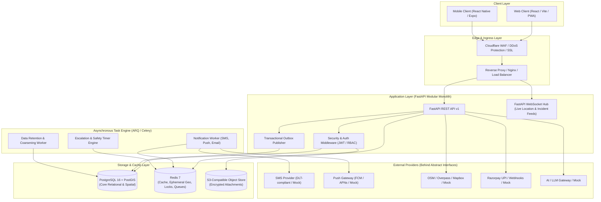
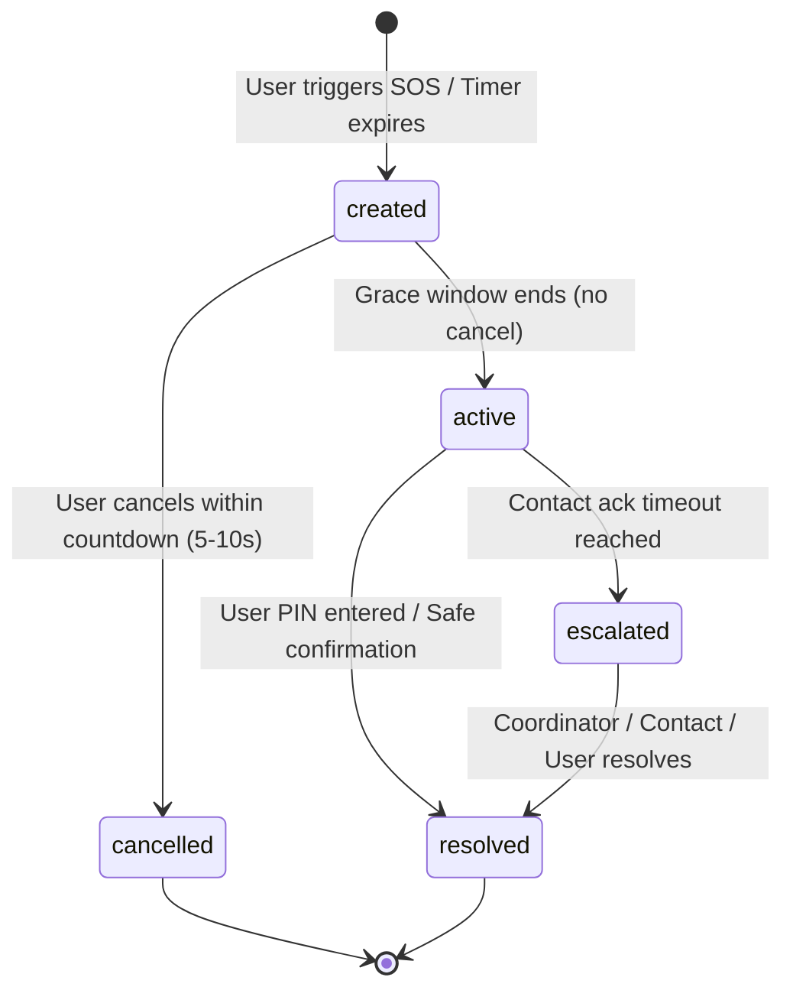
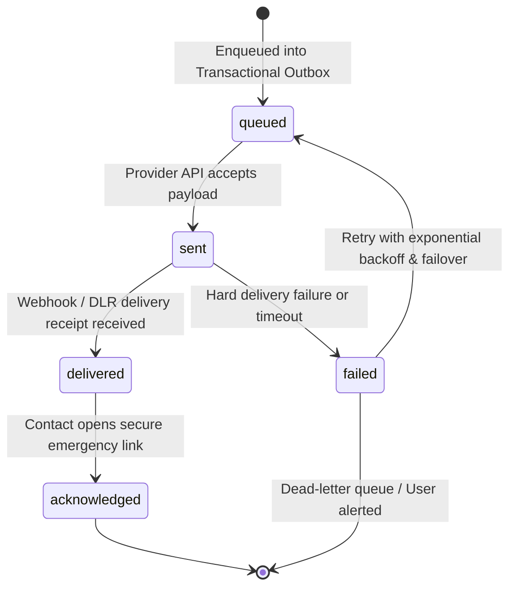

# SafeHer — System Architecture

**Document Version:** 1.0.0  
**Status:** DRAFT (Phase 0 Foundation)  
**Classification:** Confidential & Proprietary  

---

## 1. Executive Architecture Summary

SafeHer is a mission-critical, privacy-first women's safety platform built to operate reliably under extreme real-world constraints (intermittent mobile connectivity, low battery, device compromise, and panic conditions). The system provides three logically isolated product experiences on a unified, hardened core:

1. **SafeHer Personal:** Emergency SOS, Journey Guardian, server-backed Safety Timers, consent-driven Live Location Sharing, and Nearby Emergency Facilities.
2. **SafeHer Community:** Crowd-sourced, moderated civic and infrastructure safety intelligence with differential privacy and reporter pseudonymization.
3. **SafeHer Organization:** B2B institutional safety management (colleges, corporations, NGOs) featuring strict multi-tenant isolation, aggregate-only analytics, and explicit member-consented emergency escalation.

---

## 2. System Architecture Diagram

---

## 3. Subsystem Breakdown & Data Isolation

### 3.1. SafeHer Personal
- **Design Philosophy:** Zero-knowledge where possible; explicit, revocable grants for all sensitive telemetry.
- **Location Stream Ingestion:** Live coordinates are pushed to ephemeral Redis streams during active journeys or SOS incidents. Only coarse checkpoints and essential audit traces are committed to PostgreSQL.
- **Emergency Offline Fallback:** If API requests fail due to missing cellular data, the client falls back directly to hardware telephony: native 112 dialing and pre-formatted SMS to emergency contacts.

### 3.2. SafeHer Community
- **Anonymity by Design:** Community hazard reports (e.g., broken street lights, isolated pathways, harassment hotspots) strip reporter UUIDs from public queries. Moderator access to reporter identities is gated by append-only audit logging.
- **Spatial Fuzzing:** Sensitive reports (such as harassment incidents) undergo coordinate fuzzing (100–300 meter radius perturbation) before rendering on public maps to prevent victim identification or reverse-engineering home/work routines.

### 3.3. SafeHer Organization (B2B Multi-Tenancy)
- **Tenant Isolation:** Every institutional entity is scoped by `org_id`. In addition to application-level query scoping in repository classes, PostgreSQL Row-Level Security (RLS) is enforced as defense in depth.
- **Privacy Boundary:** Organizations **never** receive real-time location feeds or journey details of their members automatically. An organization coordinator is notified **only** if an affiliated user explicitly configures institutional escalation and triggers an active SOS.
- **K-Anonymity on Reporting:** Institutional safety analytics enforce a minimum cohort size ($k \ge 5$) to prevent deanonymization of individuals in small departments.

---

## 4. State Machines & Critical Workflows

### 4.1. Emergency Incident State Machine

### 4.2. Notification Delivery State Machine

### 4.3. Transactional Outbox Pattern
To prevent dual-write failure modes (e.g., database transaction commits an incident but the worker or network fails before dispatching SMS/push), SafeHer uses the **Transactional Outbox Pattern**:
1. Within a single ACID transaction, the API inserts an `emergency_incident` and corresponding `emergency_notifications` (marked `queued`) into PostgreSQL.
2. An asynchronous worker polls the outbox or listens via PostgreSQL `LISTEN/NOTIFY`.
3. Notifications are dispatched to external gateways with unique idempotency keys.
4. Provider receipts and acknowledgements update the database state machine.

---

## 5. Entity-Relationship (ER) Architecture

Below is the normalized relational schema supporting the three SafeHer products.

```mermaid
erDiagram
    users ||--o{ user_profiles : has
    users ||--o{ auth_sessions : maintains
    users ||--o{ devices : registers
    users ||--o{ emergency_contacts : designates
    users ||--o{ emergency_incidents : triggers
    users ||--o{ location_sharing_sessions : initiates
    users ||--o{ journeys : starts
    users ||--o{ safety_timers : sets
    users ||--o{ community_reports : files
    users ||--o{ consent_records : logs
    users ||--o{ organization_members : belongs_to
    users ||--o{ subscriptions : holds

    emergency_incidents ||--o{ emergency_notifications : produces
    emergency_notifications ||--o{ notification_delivery_attempts : logs
    emergency_contacts ||--o{ contact_verifications : requires
    
    journeys ||--o{ journey_participants : shares_with
    journeys ||--o{ journey_checkins : records
    
    location_sharing_sessions ||--o{ location_updates : receives
    
    community_reports ||--o{ report_attachments : includes
    community_reports ||--o{ report_moderation_actions : receives
    
    organizations ||--o{ organization_members : employs
    organizations ||--o{ organization_roles : defines
    
    subscriptions ||--o{ payments : generates
    payments ||--o{ invoices : produces

    users {
        uuid id PK
        varchar email UK
        varchar phone_number UK
        varchar hashed_password
        boolean is_active
        boolean is_verified
        varchar role
        timestamptz created_at
        timestamptz updated_at
    }

    emergency_contacts {
        uuid id PK
        uuid user_id FK
        varchar name
        varchar phone_number
        varchar email
        integer priority
        varchar relationship
        varchar location_permission
        boolean is_verified
        boolean is_active
    }

    emergency_incidents {
        uuid id PK
        uuid user_id FK
        varchar status
        geometry trigger_location
        float accuracy_meters
        varchar idempotency_key UK
        timestamptz triggered_at
        timestamptz resolved_at
        varchar resolution_reason
    }

    emergency_notifications {
        uuid id PK
        uuid incident_id FK
        uuid contact_id FK
        varchar channel
        varchar status
        varchar secure_token_hash UK
        timestamptz sent_at
        timestamptz acknowledged_at
    }

    location_sharing_sessions {
        uuid id PK
        uuid user_id FK
        varchar token_hash UK
        varchar status
        timestamptz expires_at
        timestamptz revoked_at
    }

    location_updates {
        uuid id PK
        uuid session_id FK
        geometry coordinate
        float altitude
        float speed
        float heading
        float accuracy
        timestamptz recorded_at
    }

    journeys {
        uuid id PK
        uuid user_id FK
        varchar status
        geometry origin
        geometry destination
        timestamptz estimated_arrival
        timestamptz actual_arrival
    }

    safety_timers {
        uuid id PK
        uuid user_id FK
        integer duration_minutes
        varchar status
        timestamptz expires_at
        timestamptz acknowledged_at
    }

    community_reports {
        uuid id PK
        uuid reporter_id FK
        varchar category
        varchar status
        geometry location
        geometry fuzzed_location
        text description
        boolean is_anonymous
    }

    organizations {
        uuid id PK
        varchar name
        varchar domain UK
        varchar verification_status
        boolean is_active
    }
```

---

## 6. Real-time Communication Strategy

| Communication Need | Protocol | Justification |
| :--- | :--- | :--- |
| Core Mutations (SOS, Timer, Auth) | **REST over HTTPS** | Deterministic error handling, idempotency header support, request validation, standard caching. |
| Live Location Broadcast (Responder view) | **WebSockets / SSE** | Low latency (<500ms) for real-time map marker updates without polling overhead. |
| Incident Status Updates | **SSE (Server-Sent Events)** | Unidirectional stream from server to viewer clients; native auto-reconnection. |
| Background Location Ingestion | **Batch REST POST** | Minimizes mobile radio wakeups; queues locations on device and flushes every 15–30s or on major displacement. |

---

## 7. Scalability & Cost Strategy

### 7.1. Staged Evolution
1. **Stage 1 (0–10k Active Users):**
   - Single modular FastAPI service container.
   - Primary PostgreSQL 16 instance with PostGIS extension.
   - Single Redis 7 node for cache and task queues.
   - CDN (Cloudflare) caching all static assets and Leaflet map tiles.
2. **Stage 2 (10k–500k Active Users):**
   - Horizontally scaled FastAPI API containers behind an application load balancer.
   - Dedicated notification and location ingest worker processes.
   - PostgreSQL Read Replica for read-heavy nearby-services and community queries.
   - Range-partitioning of `location_updates` table by month/week with aggressive cleanup jobs.
   - PgBouncer connection pooling.
3. **Stage 3 (500k+ Users / Multi-Region India):**
   - Ingestion service extracted for raw telemetry.
   - Geo-replicated read replicas across Northern and Southern Indian cloud zones.
   - Kafka / RabbitMQ streaming pipeline for spatial analytics and municipal data exports.

### 7.2. Unit Cost & Resource Model (Per 1,000 Active Users)
- **SMS Costs (India DLT):** Estimated ~₹0.15 to ₹0.25 per transactional SMS. For average users, SMS is restricted to verification and emergency SOS (minimizing cost by defaulting non-critical updates to free push notifications).
- **Map & Geocoding Costs:** Zero cost in Phase 0–5 using OpenStreetMap / Overpass API and CARTO/OSM free tile tiers (within reasonable fair use); planned migration to self-hosted Valhalla / TileServer-GL or commercial provider at scale.
- **Compute & Database:** Modest footprint; a single 4 vCPU / 16 GB RAM server comfortably sustains ~50k registered users with standard concurrency.
